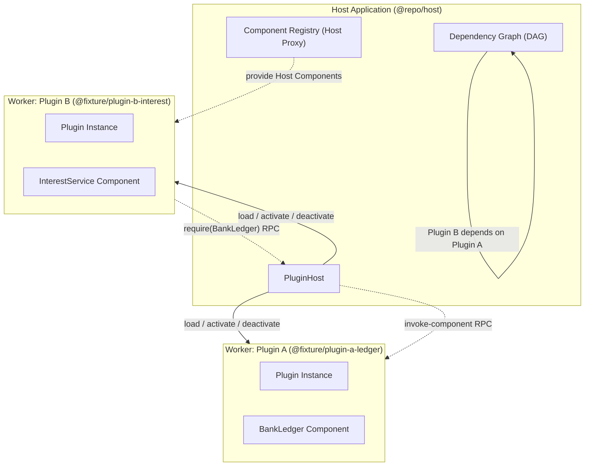

# Plugins

A modular, cross-runtime plugin system where each plugin runs in an isolated worker thread and communicates via type-safe RPC over standard messaging protocols.

Supported across **Browser**, **Bun**, and **Node.js**.

---

## Architecture Overview



---

## Monorepo Packages

| Package | Description | Location |
|---|---|---|
| **`@repo/core`** | Zero-dependency core interfaces, decorators, and worker runtime (`plugin.impl.ts`). | [`packages/core`](./packages/core) |
| **`@repo/host`** | Cross-runtime `.plugin` loader, DAG dependency management, and host proxy components. | [`packages/host`](./packages/host) |
| **`@repo/cli`** | Packager CLI that bundles entry points, manifests, and assets into `.plugin` files. | [`apps/cli`](./apps/cli) |

---

## Key Features

- **Cross-Runtime**: Runs in the Browser (Web Workers), Bun (native Web Workers), and Node.js (`worker_threads` with Web Worker compatibility bridge).
- **`.plugin` Distribution Files**: Standardized ZIP archives containing `/index.js` (entry code), `/package.json` (manifest), and `/assets/` (asset files).
- **Dynamic DAG & Circular Dependency Prevention**: Tracks dependency edges from `plugin.require(Schema)` calls. Throws `CircularDependencyError` if any cycle is detected.
- **Cascading Deactivation vs. Removal**:
  - `deactivatePlugin(name)`: Suspends target and its dependents in topological order (dependents first).
  - `removePlugin(name)`: Invokes deactivation first, terminates the worker thread, removes the plugin, and keeps dependents in a suspended deactivated state waiting for a replacement.
- **Host Proxy Components**: The host can inject components directly (`host.registerComponent`) to satisfy plugin dependencies or replace removed plugins.
- **Asset Traversal**: On-demand asset fetching (`plugin.getAsset("rates.json")`) via binary IPC streaming.

---

## Quickstart

### 1. Defining a Plugin

```typescript
import { plugin } from "@repo/core"
import { z } from "zod"

// Component Schema
export const GreeterSchema = z.object({
    sayHello: z.custom<(name: string) => string>()
})

// Component Implementation
@plugin.component(GreeterSchema)
export class GreeterImpl {
    sayHello(name: string) {
        return `Hello, ${name}!`
    }
}

plugin.onActivated = async () => {
    const asset = await plugin.getAsset("welcome.txt")
    console.log("Welcome banner:", await asset?.text())
}

export default plugin
```

### 2. Loading & Running Plugins in the Host

```typescript
import { PluginHost } from "@repo/host"

const host = new PluginHost({
    autoActivate: true,
    autoReactivateDependents: true
})

// Load .plugin file from disk or buffer
const plugin = await host.loadPlugin("./dist/my-plugin.plugin")

// Asset traversal
const assets = plugin.listAssets()
const textAsset = await plugin.getAsset("welcome.txt")
console.log(await textAsset?.text())

// Deactivate (cascades to all dependents)
await host.deactivatePlugin(plugin.name)

// Remove (deactivates first, terminates worker)
await host.removePlugin(plugin.name)
```

---

## Running the Examples & Tests

### Run the Interactive Example

```bash
bun run example
```

### Run Tests

```bash
bun test
```

### Typecheck All Workspaces

```bash
bun run typecheck
```

### Build Packages & Fixtures

```bash
bun run build
```

---

## License

MIT
